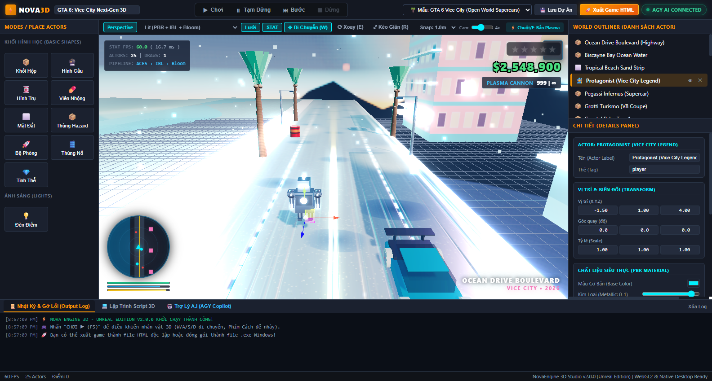
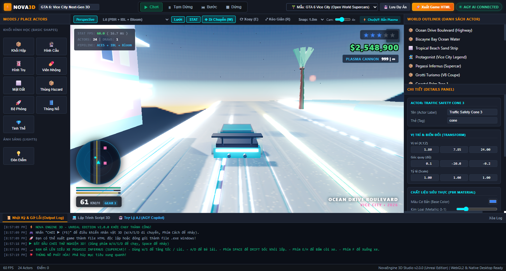

# ⚡ NovaEngine 3D - Unreal Edition (Next-Gen 3D Web & Desktop Game Engine)

**NovaEngine 3D** là một Game Engine 3D mã nguồn mở hoàn chỉnh, hiện đại mang phong cách **Unreal Engine 4 & Grand Theft Auto VI (GTA 6)**, chạy mượt mà 60 FPS cả trên **Trình duyệt Web** và **Ứng dụng Desktop Windows (.EXE)**. Bạn có thể thực hiện **100% các công đoạn làm game 3D trực tiếp trong Engine**:

- 🌐 **Repository GitHub:** [https://github.com/LeThanh9/nova-engine-3d](https://github.com/LeThanh9/nova-engine-3d)
- 🚀 **Trải nghiệm trực tuyến (GitHub Pages):** [https://lethanh9.github.io/nova-engine-3d/](https://lethanh9.github.io/nova-engine-3d/)
- 🎮 **Giao diện chuẩn Unreal Engine 4 Studio:** Bảng Modes/Place Actors bên trái, World Outliner góc trên bên phải, Details Panel góc dưới bên phải, thanh công cụ Viewport với chế độ Translate (W), Rotate (E), Scale (R), Snapping và Camera Speed.

---

## 🌴 ĐỘT PHÁ ĐỒ HỌA GTA 6: VICE CITY 2026 OPEN WORLD (AAA FIDELITY)

NovaEngine 3D đã được nâng cấp lên chuẩn đồ họa thế giới mở **Grand Theft Auto VI / Vice City**:





### 1. 🏎️ Hệ Thống Lái Siêu Xe Thể Thao (Drivable Supercars Rig):
- **Siêu xe thể thao Pegassi Infernus & Grotti Turismo:**
  - Khung gầm khí động học, kính buồng lái màu tối trong suốt, cánh gió đuôi GT Wing sợi carbon.
  - Cụm 4 bánh xe hợp kim với đĩa phanh thể thao Brembo màu đỏ, lốp cao su rãnh sâu.
  - Bánh trước tự động bẻ lái theo góc cua (`Steering Angle`), 4 bánh xe quay theo tốc độ lăn bánh thực tế.
  - Cặp đèn pha LED cực sáng chiếu 2 luồng sáng **Three.js SpotLight** rọi sáng mặt đường ban đêm.
  - Dải đèn hậu LED đỏ neon rực sáng khi nhấn phanh.
  - Cặp ống xả thể thao phụt lửa Nitro xanh/cam khi thốc ga tăng tốc.
- **Cơ chế Lên / Xuống Xe Tương Tác ([F] Enter/Exit):**
  - Tiến lại gần siêu xe trong phạm vi 4m: Icon 3D lơ lửng `[F] LÁI XE` phát sáng.
  - Nhấn phím **F**: Nhân vật bước vào xe, cửa đóng (`snd_car_door`), động cơ V8 gầm rú (`snd_engine`), camera lập tức chuyển sang góc nhìn bám đuổi phía sau xe điện ảnh (**Hollywood Chase Camera**).
  - Nhấn phím **F** một lần nữa: Nhân vật bước ra cạnh cửa xe và tiếp tục đi bộ.
- **Cơ chế Drift Phanh Tay Bốc Khói Lốp (Handbrake Drift & Tire Smoke):**
  - Khi đang phóng tốc độ cao, giữ phím **Space**: Xe rê bánh góc rộng (Oversteer), tiếng lốp rít chói tai (`snd_screech`), cụm hạt khói trắng dày đặc cuộn trào từ hai bánh sau (**Particle Drift Smoke**)!
  - Phím **E / H**: Bấm còi xe bim bim (`snd_horn`).

### 2. 🌊 Đại Lộ Bờ Biển & Sóng Biển Biscayne Bay:
- **Mặt biển nhiệt đới chuyển động gợn sóng (Dynamic Ocean Waves):**
  - Mặt phẳng biển rộng lớn với vật liệu xanh ngọc bích phản chiếu ánh nắng.
  - Đỉnh sóng nhấp nhô theo hàm sóng điều hòa đôi (`Math.sin + Math.cos`), tạo chuyển động thủy triều sống động.
- **Hàng dừa nhiệt đới đu đưa theo gió (Swaying Coconut Palms):**
  - Thân dừa uốn lượn tự nhiên với vỏ dừa vân xơ sần sùi và chùm dừa dưới tán.
  - 10 tán lá dừa xòe rộng chuyển động đung đưa uyển chuyển theo làn gió biển.
- **Khách sạn Art-Deco Miami Neon:**
  - Kiến trúc phong cách bãi biển South Beach với màu hồng flamingo và xanh ngọc pastel.
  - Dãy ban công trắng kiêu sa, các ô cửa sổ sáng đèn lung linh.
  - Bảng hiệu neon trên nóc nhà `★ HOTEL VICE ★` phát sáng rực rỡ với hiệu ứng UnrealBloomPass.
- **Mặt đường nhựa Asphalt cao tốc với vũng nước phản chiếu:**
  - Vân đường nhựa sỏi đá chi tiết, vạch kẻ đôi màu vàng ở giữa, vạch phân làn đứt đoạn màu trắng.
  - Các vũng nước đọng phản chiếu bóng khách sạn và bầu trời theo chuẩn đồ họa Next-Gen.
  - Cột đèn đường chiếu luồng sáng vàng ấm rọi xuống mặt đường.

### 3. 🎯 Giao Diện GTA 6 Next-Gen HUD:
- **Radar Mini-Map tròn xoay góc dưới bên trái:**
  - Bản đồ radar quét thời gian thực hiển thị bờ biển, trục đường đại lộ và vị trí các siêu xe (chấm xanh Cyan), khách sạn (hình hồng), thùng nổ (chấm đỏ).
  - Mũi tên định hướng nhân vật xoay đồng bộ theo hướng nhìn.
- **Thanh trạng thái Vitals:**
  - 🟩 Thanh Máu (Health - Xanh lá cây)
  - 🟦 Thanh Giáp (Armor - Xanh dương)
  - 🟨 Thể Lực (Stamina - Vàng)
- **Đồng hồ đo tốc độ điện tử (Digital Speedometer):**
  - Hiển thị tốc độ `KM/H` theo thời gian thực (lên đến 150 km/h).
  - Bộ hiển thị cấp số thông minh: `GEAR 1` đến `GEAR 5`, và số lùi `REV`.
- **Hệ Thống Truy Nã Cảnh Sát (Wanted Stars ⭐):**
  - 5 Ngôi sao truy nã GTA 6: khi va chạm tốc độ cao hoặc bắn pháo trong thành phố, mức truy nã tăng lên!
  - Các ngôi sao nhấp nháy đỏ-xanh kịch tính kèm tiếng còi hú cảnh sát (`snd_siren`) vang dội từ xa.
- **Đồng hồ tiền bạc & Vũ khí:**
  - Bộ đếm tiền chuẩn phong cách GTA: `$2,548,900`.
  - Huy hiệu súng: `PLASMA CANNON | 999 ∞`.
  - Watermark địa danh góc dưới bên phải: `OCEAN DRIVE BOULEVARD • VICE CITY 2026`.

---

## 🌟 Tính Năng Đồ Họa Chuẩn Unreal Engine 4

1. 🌌 **Bầu Trời Khí Quyển Unreal Sky Dome & Luồng Sáng Volumetric God Rays:**
   - Bầu trời vòm khí quyển Rayleigh tán xạ ánh sáng hoàng hôn và dải ngân hà huyền ảo.
   - Luồng sáng mặt trời xuyên mây (**Volumetric Sun Light Shafts / God Rays**) chiếu xiên xuống cảnh vật.
   - Hệ thống chiếu sáng 3 điểm điện ảnh UE4: Đèn chính ấm áp, đèn trời xanh Slate, đèn viền kép đối lập (**Electric Cyan & Neon Magenta Rim Lights**).

2. 🤖 **Trợ Lý A.I Tích Hợp (AGY AI Copilot Inside):**
   - Tab **"🤖 Trợ Lý A.I (AGY Copilot)"** ngay dưới đáy Engine: Bạn có thể gõ lệnh bằng Tiếng Việt hoặc bấm nút nhanh để yêu cầu AI tạo màn chơi, sinh quái vật, đổi ánh sáng hoặc tự động sửa lỗi.
   - Các lệnh nhanh mới: `🌴 Mở GTA 6 Vice City`, `🏎️ Sinh Siêu Xe`, `⭐ Bật Truy Nã 5 Sao`.
   - Đèn báo **`● AGY AI CONNECTED`** hiển thị trạng thái kết nối trực tiếp thời gian thực giữa Antigravity và Engine.

3. 💎 **Đồ Họa PBR & IBL Siêu Thực (Physically Based Rendering & Image-Based Lighting):**
   - Phản chiếu môi trường chân thực (**IBL Environment Map**) cho sơn kim loại siêu xe, áo giáp robot titanium và tinh thể năng lượng.
   - Bản đồ pháp tuyến tạo nổi (**Procedural Sobel Normal Maps**) cho mặt đường asphalt và sàn kim loại.
   - Bộ xử lý màu điện ảnh **ACESFilmic Tone Mapping** và hiệu ứng phát quang **UnrealBloomPass**.
   - Chế độ hiển thị: **Lit**, **Lighting Only (Clay)**, **Unlit**, **Wireframe**.
   - Bóng đổ mềm mịn chất lượng cao (**PCF Soft Shadows 2048x2048**).

4. 💥 **Chiến Đấu Tương Tác Vật Lý Thực (Plasma Cannon & Combat Explosions):**
   - Nhấn **Chuột Phải / Trái** hoặc **Phím Q**: Phóng đạn Pháo Năng Lượng Plasma với vệt sáng rực rỡ và đèn động.
   - Đạn phát nổ khi chạm mục tiêu, phát sóng xung kích (Shockwave Ring), rung màn hình điện ảnh (Camera Shake) và áp dụng lực đẩy vật lý (**applyImpulse**) hất tung thùng hàng xung quanh!
   - **Bệ Phóng Siêu Năng (Jump Pad):** Phóng vút 22m lên không trung kèm vòng sáng laser và âm thanh nén khí.
   - **Thùng Nổ Nguy Hiểm (Hazard Barrels):** Bắn phát hỏa thùng nổ với quả cầu lửa khổng lồ và sức ép phá hủy diện rộng.

---

## 🕹️ Phím Tắt Điều Khiển

| Phím Tắt | Chức Năng |
| :--- | :--- |
| **F** | **Lên / Xuống Siêu Xe (Enter/Exit Car)** (hoặc Bắn đạn khi đi bộ xa xe) |
| **Phím W / S** | **Tăng tốc / Lùi xe** (hoặc Chạy tới / lùi khi đi bộ) |
| **Phím A / D** | **Bẻ lái bánh xe** (hoặc Di chuyển trái / phải khi đi bộ) |
| **Phím Space (Cách)** | **DRIFT phanh tay bốc khói lốp** (hoặc Nhảy khi đi bộ) |
| **Phím E / H** | **Bấm còi xe bim bim (Car Horn)** |
| **Chuột / Phím Q** | **Bắn Pháo Năng Lượng Plasma (Combat Blast)** |
| **F5** | Chơi thử / Dừng trò chơi 3D (Play / Stop) |
| **F6** | Tiến 1 Frame (Step Debug) |
| **W / E / R** | Đổi chế độ Gizmo: Di chuyển (W), Xoay (E), Kéo giãn (R) |
| **Chuột Phải + W/A/S/D** | Bay tự do quan sát thế giới 3D (Freefly Camera) |
| **Ctrl + D** | Nhân bản nhanh Actor đang chọn |
| **Delete** | Xóa Actor đang chọn |

---

## 🔗 Các Cách Liên Kết AGY (A.I) Với Engine

Có 3 cấp độ liên kết mạnh mẽ giữa bạn (Creator), Engine và Tôi (AGY AI):

```
┌──────────────────────────┐      ┌──────────────────────────┐      ┌──────────────────────────┐
│ Cấp 1: AGY Copilot Trong │ ──►  │ Cấp 2: Chrome CDP Live   │ ──►  │ Cấp 3: Git / Source Code │
│ Giao diện Engine (Tab AI)│      │ Bắt lỗi WebGL & Soi View │      │ Tự sửa & Nâng cấp Engine │
└──────────────────────────┘      └──────────────────────────┘      └──────────────────────────┘
```

1. **Cấp 1 – Trợ Lý Tích Hợp Sẵn Trong Engine (In-Engine Copilot):**
   - Mở tab **"🤖 Trợ Lý A.I (AGY Copilot)"** dưới đáy màn hình.
   - Gõ bất kỳ lệnh nào: *"Đổi ánh sáng hoàng hôn"*, *"Tạo 5 thùng nổ"*, *"Sinh Boss khổng lồ"*, *"Quét lỗi"*.
   - Engine sẽ tự động hiểu lệnh tự nhiên và thay đổi cảnh chơi tức thì!
2. **Cấp 2 – Kết Nối Trực Tiếp Qua Chrome DevTools Protocol (CDP Live Bridge):**
   - Khi chạy trên trình duyệt hoặc Electron, tôi (AGY) kết nối ngầm vào WebGL pipeline.
   - Tôi có thể đọc lỗi Shader console, chụp ảnh màn hình Viewport để soi lỗi đồ họa, và gửi lệnh điều khiển nhân vật từ xa.
3. **Cấp 3 – Cặp Đôi Lập Trình (Autonomous Pair Programming):**
   - Tôi đọc và ghi trực tiếp vào mã nguồn của dự án tại `e:\game-engine\`.
   - Bất cứ khi nào bạn muốn thêm tính năng gì mới (như thêm quái vật, đổi cơ chế súng, làm bản đồ mới), tôi có thể viết mã trực tiếp, kiểm thử và tự động đẩy lên GitHub cho bạn!

---

## 💻 Hướng Dẫn Chạy & Đóng Gói Thành File Windows EXE

### Cách 1: Mở trực tiếp trên Trình Duyệt Web
Nhấp đúp chuột vào file:
```
e:\game-engine\index.html
```

### Cách 2: Chạy phiên bản Native Desktop App
Nhấp đúp chuột vào file:
```
e:\game-engine\Launch-NovaEngine.bat
```
Ứng dụng sẽ tự động khởi chạy với hiệu năng tăng tốc phần cứng WebGL2 GPU tối đa!

### Cách 3: Đóng gói thành file cài đặt Windows `.exe` độc lập
Nhấp đúp chuột vào file:
```
e:\game-engine\Build-Windows-EXE.bat
```
Hệ thống sẽ tự động build ứng dụng thành file Portable `.exe` lưu trong thư mục `e:\game-engine\dist\`.

---

## 🕹️ Phím Tắt Điều Khiển

| Phím Tắt | Chức Năng |
| :--- | :--- |
| **F5** | Chơi thử / Dừng trò chơi 3D (Play / Stop) |
| **F6** | Tiến 1 Frame (Step Debug) |
| **Chuột / Phím F / Q** | **Bắn Pháo Năng Lượng Plasma (Combat Blast)** |
| **W / E / R** | Đổi chế độ Gizmo: Di chuyển (W), Xoay (E), Kéo giãn (R) |
| **Chuột Phải + W/A/S/D** | Bay tự do quan sát thế giới 3D (Freefly Camera) |
| **Ctrl + D** | Nhân bản nhanh Actor đang chọn |
| **Delete** | Xóa Actor đang chọn |
| **Phím A / D / W / S** | Di chuyển nhân vật 3D trong chế độ Chơi |
| **Phím Space (Cách)** | Nhảy theo vật lý |

---

*Mã nguồn được lưu trữ tại GitHub: [https://github.com/LeThanh9/nova-engine-3d](https://github.com/LeThanh9/nova-engine-3d)*
